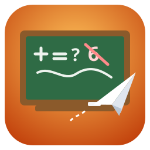

 

# SackedRecomp

**Play *Sacked: Your Last Day* (*Gefeuert! – Dein letzter Tag*) and *Crazy School* (*Schulverweis*) natively
on Windows and Linux, or right in your browser.** Both games by Limbic Entertainment are abandonware and archived
on archive.org; the converter downloads the release in the language you choose and builds the game from it, on
your machine.

SackedRecomp is an unofficial project that rebuilds the games as native programs for today's systems: no
emulator, no Wine. The games' own code is translated ahead of time ("static recompilation") and runs on a small
replacement for the parts of Windows and DirectX it uses, on top of SDL3. It is the fourth project on the
toolchain of [TropicoRecomp](https://github.com/GameRecomp/TropicoRecomp),
[CulturesRecomp](https://github.com/GameRecomp/CulturesRecomp) and
[HoMM4Recomp](https://github.com/GameRecomp/HoMM4Recomp).

> Unofficial fan project. Not affiliated with Limbic Entertainment or the games' publishers.
> This repository contains **no game code and no game data**.

## Supported releases

| Game | Languages |
|------|-----------|
| Sacked / Gefeuert! | German (CD), English, Hungarian, Polish, Dutch, Russian |
| Crazy School / Schulverweis | German (CD), Russian, Polish |

Each is pinned by its checksum ([docs/TARGETS.md](docs/TARGETS.md)).

## State

Early: the media are read and the code is being recompiled. See [docs/PLAN.md](docs/PLAN.md).

## For developers

How it works and how to build it: [docs/DEVELOPMENT.md](docs/DEVELOPMENT.md).

## License

[MIT](LICENSE) applies to the code in this repository. The games are the property of their rights holders.
